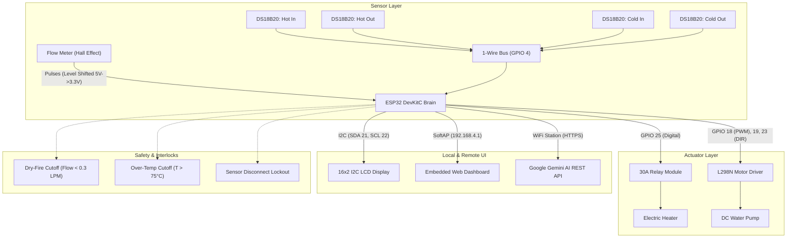

# ♨️ ESP32 Heat Exchanger Control & Telemetry System

[](https://www.espressif.com/)
[](https://www.arduino.cc/)
[](https://deepmind.google/technologies/gemini/)
[](LICENSE)

An industrial-grade embedded control, telemetry, and thermodynamic analysis system for a liquid-to-liquid heat exchanger rig powered by an **ESP32 DevKitC**.

Featuring a **30A relay heater** with hard zero-flow dry-fire prevention, an **L298N dual H-bridge motor driver** for variable water pump speed, **4x DS18B20 digital temperature sensors** on 1-Wire, a **pulse-interrupt flow meter**, an **I2C 16x2 LCD display**, a **Dual AP+Station web dashboard** with real-time live canvas charts, in-memory CSV logging, and direct edge integration with **Google Gemini 2.0 Flash AI** for autonomous optimization.

---

## 📐 Architecture & Block Diagram



---

## 📁 Repository Layout

```
heat-exchanger-controller/
├── heat_exchanger_controller.ino    # Sketch entry point
├── compile.sh                       # CLI build script (auto-bundles web assets)
├── upload.sh                        # Serial flash script
├── README.md                        # Project documentation
├── LICENSE                          # MIT License
├── .gitignore                       # Build ignore patterns
└── src/
    ├── HeatExchanger.h              # Master umbrella header
    ├── config.h                     # Hardware pins & constants
    ├── core/
    │   ├── SafetyManager.hpp        # Dry-fire cutoff, over-temp, E-Stop
    │   └── Thermodynamics.hpp       # Q_hot, Q_cold, LMTD, effectiveness
    ├── hardware/
    │   ├── ThermalSensors.hpp       # 4x DS18B20 1-Wire async manager
    │   ├── FlowSensor.hpp           # Hardware ISR pulse counter & filter
    │   ├── PumpController.hpp       # L298N LEDC PWM speed control
    │   └── HeaterController.hpp     # 30A relay control (Manual, Thermo, PWM)
    ├── network/
    │   ├── NetworkManager.hpp       # Dual AP + STA Wi-Fi & mDNS
    │   ├── GeminiClient.hpp         # Direct HTTPS Google Gemini AI client
    │   ├── WebServerManager.hpp     # REST API & telemetry endpoints
    │   └── web_dashboard.hpp        # Generated Flash PROGMEM dashboard
    ├── ui/
    │   ├── LcdManager.hpp           # 16x2 I2C display carousel & alarms
    │   └── DataLogger.hpp           # CSV circular buffer logger
    └── web/
        ├── index.html               # Semantic HTML5 UI layout
        ├── style.css                # Industrial dark-mode CSS styles
        ├── app.js                   # Client-side JavaScript logic & Canvas charts
        └── bundle.py                # Inlines HTML/CSS/JS into web_dashboard.hpp
```

---

## ⚡ Hardware Pinout Mapping

| ESP32 GPIO | Peripheral | Signal Function | Electrical Notes |
| :--- | :--- | :--- | :--- |
| **GPIO 21** | 16x2 LCD Display | I2C SDA | Default ESP32 Hardware I2C |
| **GPIO 22** | 16x2 LCD Display | I2C SCL | Default ESP32 Hardware I2C |
| **GPIO 4** | 4x DS18B20 Probes | 1-Wire Bus | 4.7kΩ pull-up resistor to 3.3V |
| **GPIO 27** | Flow Meter | Pulse Input | Hardware interrupt (via 5V->3.3V divider) |
| **GPIO 25** | 30A Relay (Heater) | Control Signal | Low at boot, active logic configurable |
| **GPIO 18** | L298N Motor Driver | ENA (PWM) | ESP32 LEDC PWM channel 0 (5 kHz) |
| **GPIO 19** | L298N Motor Driver | IN1 (Direction) | Forward enable |
| **GPIO 23** | L298N Motor Driver | IN2 (Direction) | Held LOW for single-direction pump |
| **GPIO 2** | Built-in Blue LED | Status Heartbeat | 1 Hz normal, 5 Hz on safety trip |
| **VIN / 5V** | Power Rail | 5V DC Bus | From regulated 5V power supply |
| **GND** | System Ground | Common Ground | Common to ESP32, L298N, Relay, Sensors |

---

## 🛡️ Critical Safety Interlocks

1. **Zero-Flow Dry-Fire Protection**: The heating element is strictly prevented from energizing unless liquid flow is confirmed ($> 0.3\text{ LPM}$). If flow drops below this threshold for $> 1.5\text{ s}$ while heating, the relay instantly opens with error state `DRY-FIRE (LOW FLOW)`.
2. **Over-Temperature Cutoff**: Hard limit at $75^\circ\text{C}$ (configurable in `config.h`) instantly shuts off the heater.
3. **Sensor Disconnection Detection**: Dallas 1-Wire error code ($-127^\circ\text{C}$) or open-circuit detection trips the heater immediately.
4. **Emergency Stop (E-Stop)**: Prominent hardware and software E-Stop directly cuts all outputs.

---

## 📊 Real-Time Thermodynamics Engine

The firmware computes complete thermodynamic state vectors every 1000 ms:
- **Mass Flow Rate**: $\dot{m} = \left(\frac{\dot{V}}{60}\right) \cdot \rho$ (in kg/s)
- **Heat Transfer Rate (Hot Side)**:
  $$Q_{hot} = \dot{m}_h \cdot C_p \cdot (T_{h,in} - T_{h,out}) \quad [\text{Watts}]$$
- **Heat Uptake (Cold Side)**:
  $$Q_{cold} = \dot{m}_c \cdot C_p \cdot (T_{c,out} - T_{c,in}) \quad [\text{Watts}]$$
- **Logarithmic Mean Temperature Difference (LMTD)**:
  $$\text{LMTD} = \frac{\Delta T_1 - \Delta T_2}{\ln(\Delta T_1 / \Delta T_2)}$$
  *(With automatic arithmetic fallback if $\Delta T_1 \approx \Delta T_2$ to prevent division by zero).*
- **Thermal Effectiveness**:
  $$\epsilon = \frac{T_{h,in} - T_{h,out}}{T_{h,in} - T_{c,in}} \times 100\%$$

---

## 🌐 Dual AP + Station Wi-Fi & Web UI

- **SoftAP Hotspot**: Broadcasts SSID `HeatExchanger-AP` (default IP `192.168.4.1`) for direct field monitoring without an external router.
- **Station Mode**: Concurrently connects to your local home or laboratory Wi-Fi network for internet access and direct Gemini API queries.
- **mDNS Hostname**: Accessible at `http://heatexchanger.local`.
- **Live Dashboard**:
  - Real-time HTML5 Canvas multi-line time-series charts.
  - Actuator sliders (0-100% pump PWM with soft ramping).
  - Heater modes: `OFF`, `MANUAL`, `THERMOSTATIC` (setpoint), `TIME-PWM`.
  - One-click CSV Data Export (`/api/export.csv`) for thermodynamic lab reports.

---

## 🤖 Google Gemini AI Edge Integration

The ESP32 communicates natively with the Google Gemini 2.0 Flash REST API over TLS HTTPS:
1. Formats current telemetry into a structured thermodynamic engineering prompt.
2. Gemini evaluates heat transfer efficiency, analyzes ambient thermal losses, checks for fouling or cavitation risks, and returns JSON setpoint recommendations.
3. Supports an optional **Autonomous Closed-Loop Mode** that tunes pump PWM and heater duty cycles dynamically within strict hardware safety limits.

---

## 🚀 Building & Flashing with `arduino-cli`

### Prerequisites
Install the required libraries via `arduino-cli`:
```bash
arduino-cli lib install "OneWire" "DallasTemperature" "LiquidCrystal I2C" "ArduinoJson"
```

### Compiling
```bash
./compile.sh
```
Or directly:
```bash
arduino-cli compile --fqbn esp32:esp32:esp32da .
```

### Flashing
```bash
./upload.sh /dev/ttyUSB0
```

---

## 📄 License
MIT License. Created by EnejiOhieku.
