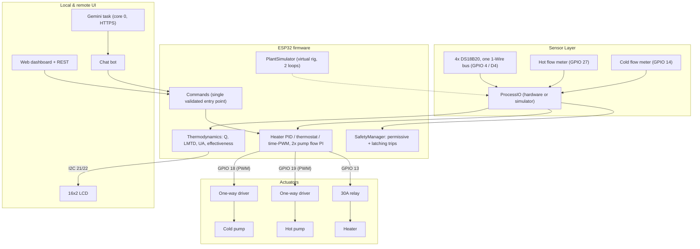

# ♨️ ESP32 Heat Exchanger Control & Telemetry System

[](https://www.espressif.com/)
[](https://www.arduino.cc/)
[](https://ai.google.dev/)
[](LICENSE)

Embedded control, telemetry and thermodynamic analysis for a liquid-to-liquid heat exchanger rig on an **ESP32 DevKitC**.

- **30 A relay heater** with five modes (Off, Manual, Thermostat, Time-PWM, **PID**), relay-life protection and a flow permissive.
- **Two one-way pumps** (hot and cold loops), each driven by a single PWM output, with soft ramp, dead-band compensation, kick-start and a closed-loop **flow setpoint** mode.
- **4x DS18B20 on one shared 1-Wire bus (GPIO4 / D4)**: slots mapped by ROM code, hot-plug re-detection.
- **Two pulse flow meters** (hot and cold loops) on IRAM interrupts with edge-period measurement.
- **16x2 I2C LCD** with address auto-detect and self-recovery.
- **Latching safety layer**: dry-fire, over-temperature, hot-side sensor fault, E-stop.
- **Simulation mode**: a virtual plant keeps the whole system working with hardware disconnected, and **Auto** falls back to it automatically on any hardware fault (returning when the fault clears).
- **Web dashboard** (offline, gzip, ~17 kB) on Dual AP + Station Wi-Fi, CSV logging.
- **Gemini assistant**: chat to query or command the rig, periodic analysis, optional slew-limited closed loop.

---

## 📐 Architecture



---

## 📁 Repository Layout

```
heat_exchanger_controller/
├── heat_exchanger_controller.ino    # Scheduler: 10 Hz control, 4 Hz LCD, 1 Hz thermo/log
├── compile.sh / upload.sh           # arduino-cli build (bundles web assets) and flash
└── src/
    ├── config.h                     # Pins, limits, tuning defaults
    ├── core/
    │   ├── SafetyManager.hpp        # Flow permissive, latching trips, warnings
    │   ├── Pid.hpp                  # PID with anti-windup, D-on-measurement, bumpless start
    │   ├── Thermodynamics.hpp       # Q_hot, Q_cold, LMTD, UA, effectiveness
    │   ├── ProcessIO.hpp            # Routes process values to hardware or simulator
    │   ├── CommandExec.hpp          # All actuator commands (REST, chat, AI) validated here
    │   └── SettingsStore.hpp        # NVS persistence of calibration and tuning
    ├── hardware/
    │   ├── ThermalSensors.hpp       # shared 1-Wire bus, ROM-mapped probes, async conversions
    │   ├── FlowSensor.hpp/.cpp      # 2x IRAM ISR + edge-period flow measurement
    │   ├── PumpController.hpp       # one-way single-PWM pumps (hot + cold), ramp, kick-start, flow PI
    │   └── HeaterController.hpp     # Relay modes incl. PID time-proportioning
    ├── sim/PlantSimulator.hpp       # Tank + counter-flow e-NTU exchanger model (2 loops)
    ├── network/
    │   ├── NetworkManager.hpp       # AP + STA Wi-Fi, mDNS
    │   ├── GeminiClient.hpp         # Async Gemini REST client (FreeRTOS task)
    │   ├── ChatBot.hpp              # Offline commands + Gemini chat + AI closed loop
    │   ├── WebServerManager.hpp     # REST API
    │   └── web_dashboard.hpp        # GENERATED gzip dashboard
    ├── ui/LcdManager.hpp, DataLogger.hpp
    └── web/index.html, style.css, app.js, simulator.js, bundle.py, build_site.py
docs/                                # generated hosted simulator (GitHub Pages)
```

---

## ⚡ Hardware Pinout

| ESP32 GPIO | Peripheral | Signal | Notes |
| :--- | :--- | :--- | :--- |
| **21 / 22** | 16x2 LCD (PCF8574 backpack) | I2C SDA / SCL | Address auto-detected (0x27, 0x3F, 0x20-0x27, 0x38-0x3F) |
| **4 (D4)** | 4x DS18B20 **shared 1-Wire bus** | 1-Wire | **one 4.7 kΩ pull-up to 3.3 V** (breakout boards often include one; do not stack several in parallel) |
| **27** | Hot-loop flow meter | Pulse input | IRAM ISR, 1 kΩ / 2 kΩ divider from 5 V |
| **14** | Cold-loop flow meter | Pulse input | IRAM ISR, 1 kΩ / 2 kΩ divider from 5 V |
| **13** | 30 A relay (heater) | Digital out | Active level set by `RELAY_ACTIVE_LEVEL` |
| **19** | Hot pump driver | LEDC PWM | One-way, 5 kHz, 10-bit |
| **18** | Cold pump driver | LEDC PWM | One-way, 5 kHz, 10-bit |
| **2** | On-board LED | Status | 1 Hz heartbeat, 5 Hz flash on trip |
| Free | 16, 17, 23, 25, 26, 32, 33 | Expansion | 34-39 are input-only |

All four DS18B20s are powered (3-wire: VDD, DQ, GND), not parasitic, and share GPIO4. Because they are on one bus, the firmware binds each 64-bit ROM code to a slot (Hot In / Hot Out / Cold In / Cold Out) on first scan and keeps that mapping; the serial log and Status tab show the ROMs, and `swap_probes a b` reorders two slots if they were auto-assigned the wrong way round.

---

## 🎛️ Control

| Heater mode | Behaviour |
| :--- | :--- |
| Off | Relay open. Boot default. |
| Manual | Operator relay on/off (arming manual mode never turns it on by itself). |
| Thermostat | On/off with hysteresis. Off is immediate; re-energise is limited to once per 5 s. |
| Time-PWM | Fixed duty over a 10 s window. Slices shorter than 1 s are absorbed (relay life). |
| PID | PID on the selected probe (default Th,in) → duty → time-proportioned relay. Anti-windup, derivative on measurement, integrator held while the flow permissive is missing. |

**Pump**: manual % or **flow setpoint** (PI loop on measured L/min, bumpless transfer). 1-100 % is mapped onto `[min duty, 100 %]` so the bottom of the slider is not a dead band; starting from standstill gives a 250 ms full-duty kick; direction reversal ramps to zero first.

> A mechanical 30 A relay is good for ~10⁵ electrical cycles. For continuous PID control use an SSR on the same pin.

---

## 🛡️ Safety

1. **Flow permissive (non-latching)**: the heater can only energise with flow ≥ 0.3 L/min. Missing flow just holds it off and shows a warning.
2. **Dry-fire trip (latching)**: flow lost for > 1.5 s *while the relay is energised*.
3. **Over-temperature trip (latching)**: any valid probe ≥ 75 °C.
4. **Hot-side sensor fault (latching)**: Th,in or Th,out invalid after the 4 s boot grace. A probe is invalid after 3 consecutive bad reads (-127 °C/CRC failure, the 85 °C power-on-reset value, or out of range). Cold-side faults are warnings only.
5. **E-stop**: heater off and pump stopped instantly.
6. **Reset** only clears a trip once its cause is gone. AI sources can never reset a trip or change the simulation mode.

---

## 🧪 Simulation (backup) mode

`Settings → Simulation`: **Off**, **On**, or **Auto** (default: simulate if no DS18B20 answers at boot).
The simulator models a 2 kW heater in a 3 kg tank feeding a counter-flow exchanger (ε-NTU, UA = 180 W/K) with a 20 °C cold supply, two independent pump curves, probe lag, noise and 0.0625 °C quantisation. It is driven by the real controllers, so the PID, safety interlocks, logging, LCD, dashboard and AI all behave as on the real rig.

- Physical relay and pump outputs are **held off** while simulating, and switching modes always forces heater off and both pumps stopped.
- In **Auto**, any hardware fault (missing or invalid probe) switches to the virtual plant and it returns to real hardware automatically when the fault clears.
- Faults can be injected (hot/cold flow blockage, Th,in probe loss, welded relay) to demonstrate the interlocks.
- Everything is labelled SIM: LCD IP line, dashboard banner, CSV `Source` column, Gemini context.

---

## 🤖 Gemini assistant & chat

The Assistant tab has a chat box.
- **Offline commands** (no internet needed): `status`, `pump 40`, `pump off`, `flow 2.5`, `coldpump 40`, `coldpump off`, `coldflow 2.5`, `heater pid|thermo|pwm|manual|off`, `heater on`, `setpoint 55`, `duty 30`, `swap 0 1`, `assign 0 <ROM>`, `estop`, `reset`, `sim on|off|auto`, `clear log`, `help`.
- **Anything else** goes to Gemini with a live telemetry snapshot. Gemini answers and may propose commands; they run only when you press **Execute** (or enable *Auto-run AI commands*). Proposed commands go through the same validation and interlocks as the UI.

**Reliability fixes vs. the previous client**
- The old default `gemini-2.0-flash` (and 1.5 models) are **shut down** by Google; `gemini-2.5-*` retire Dec 2026. Default is now `gemini-3.6-flash`, retired IDs stored in flash are migrated automatically, and a custom model ID can be entered.
- Requests run in a FreeRTOS task on core 0, so control and safety keep running during the 2-40 s round trip.
- `HTTPClient` handles chunked responses (the old raw socket corrupted them); HTTP status codes and Google's error message are shown in the UI.
- Structured output (`responseMimeType` + `responseSchema`) replaces markdown stripping, with an automatic retry without schema/thinking options on HTTP 400, retry on 500/503 and 60 s backoff on 429.
- The API key is sent in the `x-goog-api-key` header, not the URL.
- Unparseable replies are never treated as valid setpoints.

**AI closed loop** (opt-in): each recommendation is applied once, only if fresh, never while tripped or when the model flags a risk; hot/cold pump changes are limited to ±15 % per step (manual pump mode only), heater duty to ±20 % and only in Time-PWM mode. The AI never switches the heater on from Off.

---

## 📊 Thermodynamics

- $\dot m = \dot V/60 \cdot \rho$, $Q_{hot} = \dot m_{hot} c_p (T_{h,in}-T_{h,out})$, $Q_{cold} = \dot m_{cold} c_p (T_{c,out}-T_{c,in})$ (one meter per loop)
- Counter-flow $\text{LMTD} = \frac{\Delta T_1 - \Delta T_2}{\ln(\Delta T_1/\Delta T_2)}$ with arithmetic fallback
- $UA = Q_{hot}/\text{LMTD}$: a falling UA at the same flow indicates fouling
- $\varepsilon = Q/(C_{min}(T_{h,in}-T_{c,in}))$ with $C_{min}$ from the smaller of the two loop capacity rates

Values are only computed when all four probes are valid.

---

## 🌐 REST API

| Method | Path | Purpose |
| :--- | :--- | :--- |
| GET | `/api/telemetry` | Full state (process values, probes, actuators, safety, config, AI) |
| POST | `/api/control` | `pump_pct`, `flow_setpoint`, `pump_stop`, `cold_pump_pct`, `cold_flow_setpoint`, `cold_pump_stop`, `heater_mode`, `heater_manual`, `heater_duty`, `target_temp`, `estop`, `reset_fault`, `swap_probes`, `assign_probe` |
| POST | `/api/config` | Wi-Fi, `flow_k_factor`, `cold_flow_k_factor`, `kp/ki/kd`, `hysteresis`, `control_probe`, `pump_min_duty`, `flow_kp/ki`, `cold_pump_min_duty`, `cold_flow_kp/ki`, `sim_mode`, `sim_faults` |
| POST | `/api/ai/config` | `api_key`, `model`, `auto_interval_ms`, `closed_loop`, `chat_auto_exec` |
| POST | `/api/ai/query` | Queue an analysis (202) |
| GET/POST | `/api/chat` | Read history / send `{message}` |
| POST | `/api/chat/execute` | Run the commands proposed in message `{id}` |
| GET | `/api/wifi/scan` | Non-blocking network scan |
| GET | `/api/export.csv` | CSV log download |

---

## 🚀 Building & Flashing

```bash
arduino-cli lib install "OneWire" "DallasTemperature" "LiquidCrystal I2C" "ArduinoJson"
```

```bash
./compile.sh
```

```bash
./upload.sh /dev/ttyUSB0
```

The build uses the **Minimal SPIFFS (1.9 MB app, OTA)** partition scheme (`esp32:esp32:esp32da:PartitionScheme=min_spiffs`); NVS settings are preserved. `compile.sh` runs `src/web/bundle.py`, which also writes `build/dashboard_preview.html` for desktop previewing.

---

## 🌐 Hosted simulator (GitHub Pages)

The dashboard can also run entirely in a browser with no ESP32 attached. `src/web/simulator.js` is a JavaScript port of the virtual rig (plant, thermodynamics, PID, latching safety, both pumps and flow meters) that answers the dashboard's `/api/*` calls locally, so the same UI — KPIs, trend chart, controls, Status tab and CSV export — runs on any static host.

It boots into a running example (heater PID to 50 °C, hot pump 60 %, cold pump 50 %) so it produces data immediately. Change setpoints, inject faults and download the CSV exactly as on the real rig.

**Gemini in the browser:** the Assistant tab works on the hosted page too. It calls the Generative Language API directly from the browser and **streams chat replies back token-by-token** (`:streamGenerateContent` SSE), so answers appear as they are written. The API key can be shared by everybody in one of two ways:

- **Baked into the page (shared by every visitor):** copy `src/web/site.config.example.js` to `src/web/site.config.js`, paste a key, and rebuild. `site.config.js` is gitignored, but the built `docs/index.html` then contains the key in plain text - that is what lets one key serve everyone with no per-browser paste. Restrict the key in Google Cloud Console to the *Generative Language API* and to your site's HTTP referrer, and only bake a key you are willing to expose. Instead of a file you can pass it at build time: `HX_GEMINI_API_KEY=AIza... python3 src/web/build_site.py` or `python3 src/web/build_site.py --api-key AIza... --model gemini-3.6-flash`. When a shared key is active the key field is locked and the key is never copied into `localStorage`.
- **Per-browser:** if no key is baked in, each visitor pastes their own and it is stored in that browser's `localStorage` - it is never committed to the repo.

If the default model id is not available to your key, choose **Custom model id** and enter one you can access. Chat, "Analyse now" and the optional closed loop all run client-side; the AI still cannot reset a trip.

**Build the site**

```bash
python3 src/web/build_site.py
# -> docs/index.html (one self-contained file) + docs/.nojekyll
```

**Preview locally**

```bash
python3 -m http.server -d docs
# open http://localhost:8000
```

**Publish with GitHub Pages**

Option A - **key from a repository secret (no key in git)**: commit the workflow `.github/workflows/deploy-pages.yml` (already in this repo), then

1. GitHub -> **Settings -> Secrets and variables -> Actions** -> **New repository secret**: `GEMINI_API_KEY` = your key. Optionally add a **variable** `GEMINI_MODEL` (e.g. `gemini-3.6-flash`).
2. GitHub -> **Settings -> Pages** -> **Source: GitHub Actions** (not "Deploy from a branch").
3. Push to `main` (or run *Deploy hosted dashboard* manually). The workflow rebuilds `docs/index.html` with the key injected from the secret and publishes it, so `docs/index.html` in git stays keyless.
4. After a minute: `https://enejiohieku.github.io/heat-exchanger-controller/`

> A secret only hides the key from the repository, **not from visitors**: Pages serves `index.html` publicly, so the key is still readable in the page. GitHub masks it in workflow logs, and rotating it is just editing the secret and re-running the workflow. If the key must not be public at all, put a small proxy (e.g. a Cloudflare Worker) in front of Gemini and keep the secret there instead.

Option B - **deploy from the branch**: **Source** -> *Deploy from a branch*, branch `main`, folder `/docs`. This needs no CI, but the committed page must already contain the key (bake it locally via `site.config.js` and commit `docs/`). Re-run `build_site.py` and commit `docs/` whenever `src/web/*` changes - and remember that commits keep the key in git history.

If neither a secret nor a baked key is present, the page simply asks each visitor for their own key and keeps it in their browser.

**Or use your portfolio site**

Copy `docs/index.html` into the `enejiohieku.github.io` repo (for example as `heat-sim/index.html`) and it is live at `https://enejiohieku.github.io/heat-sim/`.

---

## 📄 License
MIT License. Created by EnejiOhieku.
